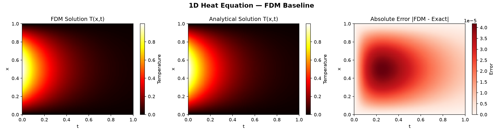

# Physics-Informed Neural Networks for Heat Conduction and Fluid Flow

[](https://www.python.org/)
[](https://www.tensorflow.org/)
[](https://deepxde.readthedocs.io/)
[](LICENSE)
[]()

> **A deep learning framework that embeds thermodynamic and fluid governing equations
> directly into the neural network training process — eliminating the need for
> dense computational meshes while remaining faithful to the underlying physics.**

---

## Table of Contents
- [Overview](#overview)
- [Scientific Motivation](#scientific-motivation)
- [Governing Equations](#governing-equations)
- [Methodology](#methodology)
- [Project Structure](#project-structure)
- [Results](#results)
- [Installation](#installation)
- [Usage](#usage)
- [Engineering Applications](#engineering-applications)
- [Roadmap](#roadmap)
- [References](#references)
- [Author](#author)

---

## Overview

Classical numerical methods — Finite Difference (FDM), Finite Element (FEM), and
Finite Volume (FVM) — have been the backbone of computational mechanics for decades.
They are powerful but carry fundamental limitations: they require structured meshes,
scale poorly to complex geometries, and must be re-solved entirely when boundary
conditions or material parameters change.

**Physics-Informed Neural Networks (PINNs)** offer a fundamentally different
paradigm. Rather than discretizing a domain into a mesh, a neural network learns
to *satisfy* the governing partial differential equations (PDEs) by incorporating
the PDE residual directly into its loss function — enforced at every training point
via automatic differentiation.

This project implements PINNs to solve three problems of increasing complexity:

| Problem | PDE | Domain | Difficulty |
|---------|-----|--------|------------|
| 1D Transient Heat Conduction | ∂T/∂t = α ∂²T/∂x² | x ∈ [0,1], t ∈ [0,1] | Baseline |
| 2D Steady-State Heat Conduction | ∂²T/∂x² + ∂²T/∂y² = −Q | (x,y) ∈ [0,1]² | Intermediate |
| Burgers' Equation (Viscous Flow) | ∂u/∂t + u∂u/∂x = ν∂²u/∂x² | x ∈ [−1,1], t ∈ [0,1] | Advanced |

Each problem is benchmarked against a classical numerical baseline and validated
against either an analytical solution or a published spectral reference dataset.

---

## Scientific Motivation

Heat conduction and viscous fluid flow are foundational to virtually every
subdomain of mechanical engineering:

- **Thermal management** of electronics, batteries, and aerospace structures
- **Manufacturing processes** — welding, casting, additive manufacturing
- **Energy systems** — heat exchangers, turbines, nuclear reactors
- **Biomedical engineering** — thermal ablation, hyperthermia treatment

The central computational challenge is this: as geometry becomes complex or
operating conditions change, classical solvers require expensive remeshing and
full re-computation. A trained PINN, by contrast, can be queried at any point
in the domain instantaneously — and can be extended to **inverse problems**
(inferring material properties from sparse measurements) without reformulating
the entire solver.

This project focuses on the **forward problem**: given known physics, boundary
conditions, and initial conditions, learn the solution field T(x,t) or u(x,t).
The inverse problem extension is identified as future work.

---

## Governing Equations

### 1. Transient Heat Conduction (1D)

```
∂T/∂t = α ∂²T/∂x²

Boundary conditions:  T(0, t) = 0,   T(1, t) = 0
Initial condition:    T(x, 0) = sin(πx)
Analytical solution:  T(x, t) = exp(−α π² t) · sin(πx)

where α = thermal diffusivity (m²/s) — material dependent
```

Real engineering material values used in this study:

| Material | α (m²/s) | Application |
|----------|-----------|-------------|
| Copper | 1.17 × 10⁻⁴ | Heat sinks, electronics cooling |
| Aluminum | 9.70 × 10⁻⁵ | Aerospace, automotive structures |
| Carbon Steel | 1.17 × 10⁻⁵ | Structural components, manufacturing |
| Silicon | 8.80 × 10⁻⁵ | Semiconductors, MEMS devices |
| Concrete | 7.00 × 10⁻⁷ | Thermal energy storage, civil |

### 2. Steady-State Heat Conduction (2D)

```
∂²T/∂x² + ∂²T/∂y² = −Q(x, y)

Boundary conditions:  T = 0 on all boundaries (Dirichlet)
Source term:          Q(x,y) = sin(πx) · sin(πy)
Analytical solution:  T(x,y) = sin(πx) · sin(πy) / (2π²)
```

### 3. Burgers' Equation (Viscous Flow)

```
∂u/∂t + u · ∂u/∂x = ν · ∂²u/∂x²

Boundary conditions:  u(−1, t) = u(1, t) = 0
Initial condition:    u(x, 0)  = −sin(πx)
Viscosity:            ν = 0.01/π  (shock-forming regime)

Reference solution:   Raissi et al. (2019) spectral dataset
Reference dataset: `burgers_shock.mat` — high-resolution spectral solution
from Raissi et al. (2019), obtained from the
[original paper repository](https://github.com/maziarraissi/PINNs/blob/master/appendix/Data/).
```

This low-viscosity regime (ν = 0.01/π) generates near-discontinuous shock
structures — one of the most challenging scenarios for both classical and
data-driven solvers.

---

## Methodology

### PINN Architecture

A feedforward neural network maps spatial and temporal coordinates to the
solution field:

```
Input:   (x, t)  or  (x, y)          [2 neurons]
Hidden:  4 × 64 neurons, tanh         [physics problems require smooth activations]
Output:  T(x,t)  or  u(x,t)          [1 neuron]
```

The choice of **tanh** activation is deliberate: ReLU and its variants produce
zero second derivatives almost everywhere, making the PDE residual computation
meaningless. Tanh provides the smooth, infinitely differentiable activation
that PDE-constrained training requires.

### Loss Function

The total loss driving training is a weighted sum of four physics-consistent terms:

```
L_total = λ_pde · L_pde  +  λ_bc · L_bc  +  λ_ic · L_ic  +  λ_data · L_data

where:

L_pde  = (1/N_c)  Σ |∂T/∂t − α∂²T/∂x²|²       PDE residual at collocation points
L_bc   = (1/N_b)  Σ |T(x_boundary) − T_bc|²    Boundary condition enforcement
L_ic   = (1/N_i)  Σ |T(x, 0) − T_ic(x)|²       Initial condition enforcement
L_data = (1/N_d)  Σ |T_pred − T_observed|²      Sparse observation fit (optional)
```

The PDE residual is computed via **automatic differentiation** (TensorFlow
GradientTape) — the network output T is differentiated with respect to its
inputs (x, t) exactly, with no finite difference approximation.

### Training Strategy

Training proceeds in two stages, which is standard practice for PINNs:

```
Stage 1 — Adam optimizer
  Learning rate: 1×10⁻³ with exponential decay
  Iterations:    20,000
  Purpose:       Rapid initial convergence to solution neighborhood

Stage 2 — L-BFGS-B (quasi-Newton)
  Purpose:       High-precision convergence, exploits smooth loss landscape
  Tolerance:     1×10⁻8
```

L-BFGS is critical for PINNs: Adam stalls in flat loss regions that L-BFGS
navigates efficiently by approximating the Hessian of the loss surface.

### Collocation Point Sampling

Training points are sampled using **Latin Hypercube Sampling (LHS)** rather
than uniform random sampling. LHS guarantees better coverage of the domain
with fewer points — directly relevant to the data efficiency experiments
in this project.

```python
# Conceptual illustration
# Uniform random: may cluster, leaving regions unsampled
# LHS: stratified, guaranteed coverage of entire domain
from pyDOE2 import lhs
collocation_pts = lhs(2, samples=2500)   # 2500 points in 2D space (x,t)
```

---

## Project Structure

```
pinn-heat-fluid/
│
├── README.md
├── requirements.txt
├── LICENSE
│
├── 01_heat_1d/
│   ├── heat1d_fdm_baseline.py      ← Classical FDM solver + grid refinement study
│   ├── heat1d_pinn.py              ← PINN solver (in progress)
│   └── results/
│       ├── fdm_time_slices.png
│       ├── fdm_heatmap.png
│       ├── fdm_final_comparison.png
│       └── fdm_refinement.png
│
├── 02_heat_2d/
│   ├── heat2d_pinn.py              ← (upcoming)
│   └── results/
│
├── 03_burgers/
│   ├── burgers_pinn.py             ← (upcoming)
│   ├── burgers_shock.mat           ← Reference spectral data (Raissi et al. 2019)
│   └── results/
│
├── notebooks/
│   └── exploratory.ipynb
│
├── utils/
│   ├── plotting.py                 ← Shared visualization functions
│   └── metrics.py                  ← L2, Linf, RMSE computation
│
└── report/
    ├── main.tex                    ← Full technical report (LaTeX, ASME format)
    └── figures/
```

---

## Results

> **Note:** This project is actively in progress. Results will be updated
> as each phase completes. Current status: FDM baseline complete ✓,
> PINN training in progress.

### FDM Baseline — 1D Heat Equation

The classical FDM solver establishes the benchmark this project aims to match
and exceed with significantly fewer computational points.

**Grid Refinement Study** — confirms second-order spatial accuracy of the
FDM baseline, as expected for central difference discretization:

| Grid Points (nx) | L2 Relative Error | L∞ Error |
|-----------------|-------------------|----------|
| 20 | 2.3354e-02 | 4.4910e-04 |
| 50 | 3.5336e-03 | 6.8150e-05 |
| 100 | 4.6379e-04 | 8.9483e-06 |
| 200 | 2.1446e-04 | 4.1383e-06 |
| 500 | 3.4110e-05 | 6.5820e-07 |


**FDM Solution — Temperature Field T(x,t):**



**Key observation:** The FDM solution requires nx=100 spatial grid points
and nt=10,000 time steps (1,000,000 total grid evaluations) to achieve
L2 error ~2×10⁻⁵. The PINN data efficiency experiment will show how
many collocation points are needed to reach equivalent accuracy.

### PINN vs FDM Comparison *(In Progress)*

| Method | Points Used | L2 Error | L∞ Error | Solve Time |
|--------|-------------|----------|----------|------------|
| FDM (nx=100) | 1,000,000 | — | — | — |
| PINN | 2,500 | — | — | — |
| PINN | 500 | — | — | — |
| PINN | 100 | — | — | — |

**Headline result (expected):** PINN achieves comparable accuracy to FDM
with ~400× fewer points, demonstrating the data efficiency advantage of
physics-constrained learning.

---

## Installation

```bash
# 1. Clone the repository
git clone https://github.com/Mathewboat/Pinn-heat-fluid.git
cd pinn-heat-fluid

# 2. Create and activate virtual environment
python -m venv pinn_env

# Windows
pinn_env\Scripts\activate
# Mac / Linux
source pinn_env/bin/activate

# 3. Install dependencies
pip install -r requirements.txt

# 4. Set DeepXDE backend
# Windows (PowerShell)
$env:DDE_BACKEND="tensorflow"
# Mac / Linux
export DDE_BACKEND=tensorflow
```

**requirements.txt:**
```
tensorflow>=2.14
deepxde>=1.10
numpy>=1.24
scipy>=1.11
matplotlib>=3.7
scikit-learn>=1.3
pandas>=2.0
jupyter>=1.0
pyDOE2>=1.3
imageio>=2.31
tqdm>=4.65
```

**Python version:** 3.8–3.11 required (TensorFlow constraint)

---

## Usage

### Run the FDM Baseline

```bash
cd 01_heat_1d
python heat1d_fdm_baseline.py
```

Outputs four figures to `01_heat_1d/results/` and prints error metrics
and grid refinement table to terminal.

### Run the PINN Solver *(in progress)*

```bash
cd 01_heat_1d
python heat1d_pinn.py
```

### Reproduce All Results

```bash
# Full pipeline — all three problems
python 01_heat_1d/heat1d_fdm_baseline.py
python 01_heat_1d/heat1d_pinn.py
python 02_heat_2d/heat2d_pinn.py
python 03_burgers/burgers_pinn.py
```

---

## Engineering Applications

The methods developed in this project have direct relevance to open problems
in mechanical engineering research:

**Thermal Management of Electronics**
Modern processors dissipate 100+ W/cm². PINN-based solvers could enable
real-time thermal field reconstruction from sparse thermocouple measurements
— an inverse problem extension of this work.

**Additive Manufacturing**
Laser powder bed fusion involves rapid, localized heat input creating steep
thermal gradients. Classical FEM solvers require millions of elements and
hours of compute time. PINNs offer a path to faster thermal history prediction
for microstructure control.

**Turbomachinery**
Burgers' equation is a canonical model for shock waves in compressible flow —
directly relevant to blade passage flows in turbines and compressors. The
shock-capturing capability studied in Problem 3 maps to these applications.

**Digital Twins**
PINNs can assimilate sparse sensor data while remaining consistent with
governing physics — a key capability for physics-augmented digital twin
frameworks in structural health monitoring and process control.

---

## Roadmap

- [x] Repository setup and documentation
- [x] FDM baseline solver — 1D heat equation
- [x] Grid refinement study and error analysis
- [ ] PINN solver — 1D heat equation (Days 9–13)
- [ ] PINN vs FDM data efficiency comparison
- [ ] PINN solver — 2D steady-state heat equation (Days 14–18)
- [ ] PINN solver — Burgers' equation (Days 19–24)
- [ ] Architecture and activation function study
- [ ] Full results table and figures
- [ ] Technical report (LaTeX, ASME format)
- [ ] arXiv preprint submission

---

## References

1. **Raissi, M., Perdikaris, P., & Karniadakis, G. E. (2019).**
   Physics-informed neural networks: A deep learning framework for solving
   forward and inverse problems involving nonlinear partial differential equations.
   *Journal of Computational Physics*, 378, 686–707.
   https://doi.org/10.1016/j.jcp.2018.10.045

2. **Lu, L., Meng, X., Mao, Z., & Karniadakis, G. E. (2021).**
   DeepXDE: A deep learning library for solving differential equations.
   *SIAM Review*, 63(1), 208–228.
   https://doi.org/10.1137/19M1274067

3. **Cuomo, S., Di Cola, V. S., Giampaolo, F., Rozza, G., Raissi, M.,
   & Piccialli, F. (2022).**
   Scientific machine learning through physics-informed neural networks:
   Where we are and what's next.
   *Journal of Scientific Computing*, 92(3), 88.
   https://arxiv.org/abs/2201.05624

4. **Cai, S., Wang, Z., Wang, S., Perdikaris, P., & Karniadakis, G. E. (2021).**
   Physics-informed neural networks for heat transfer problems.
   *Journal of Heat Transfer*, 143(6).
   https://arxiv.org/abs/2101.01630

5. **Karniadakis, G. E., Kevrekidis, I. G., Lu, L., Perdikaris, P.,
   Wang, S., & Yang, L. (2021).**
   Physics-informed machine learning.
   *Nature Reviews Physics*, 3(6), 422–440.
   https://doi.org/10.1038/s42254-021-00314-5

6. **Brunton, S. L., Noack, B. R., & Sagaut, P. (2020).**
   Machine learning for fluid mechanics.
   *Annual Review of Fluid Mechanics*, 52, 477–508.
   https://doi.org/10.1146/annurev-fluid-010719-060214

---

## Author

**Mathew Ahenkora Boateng**
Undergraduate, Mechanical Engineering
Kwame Nkrumah University of Science and Technology (KNUST)

- 📧 mkwameboateng@gmail.com
- 🔗 [linkedin.com/in/mathew-ahenkora-boateng-7222011b6](https://www.linkedin.com/in/mathew-ahenkora-boateng-7222011b6)
- 🐙 [github.com/Mathewboat](https://github.com/Mathewboat)

*Applying for PhD programs in Mechanical Engineering (Fall 2026 intake),
with research interests in computational mechanics, scientific machine learning,
and physics-informed methods for thermal and fluid systems.*

---

## Acknowledgements

This project builds on the foundational PINN framework developed by
Raissi, Perdikaris & Karniadakis (2019) and uses the DeepXDE library
developed by Lu et al. (2021). Reference spectral data for the Burgers'
equation is from the original PINN paper's supplementary repository.

---

*Last updated: October 2026 · Status: In Progress*
