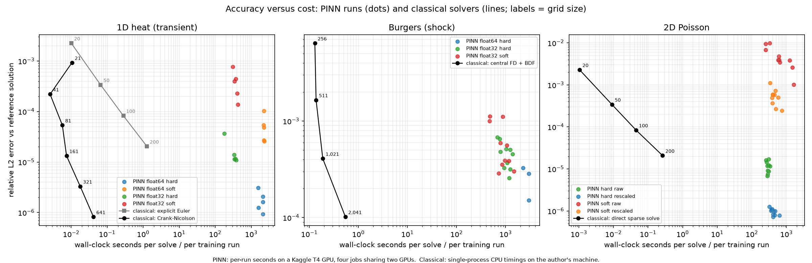
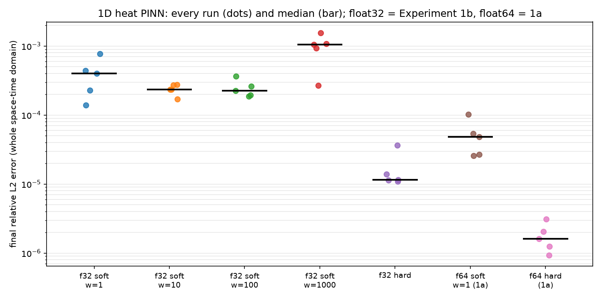
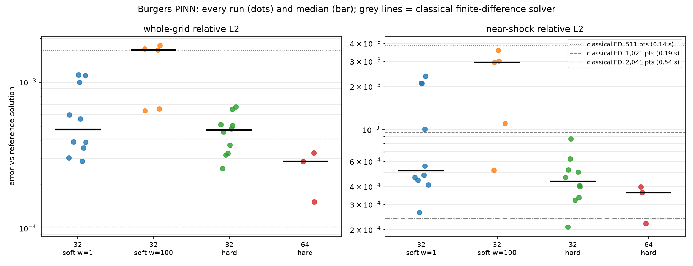
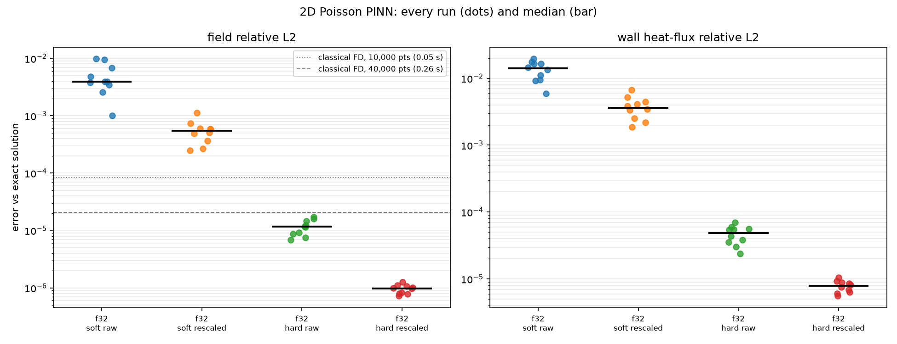

# Physics-Informed Neural Networks for Heat Conduction and Viscous Flow

### A controlled comparison with classical solvers

[](https://deepxde.readthedocs.io/)
[](https://www.tensorflow.org/)
[](LICENSE)

## Summary

This repository is a reproducible study of **what actually drives the accuracy of physics-informed neural networks (PINNs)**
on three PDEs from heat transfer and fluid mechanics, benchmarked against strong classical solvers. It contains
**113 GPU training runs** (5-10 independent runs per setting), the code, the raw per-run results, and an explicit record of
the mistakes made along the way ([Corrections log](#corrections-log)).

| problem | PDE | reference solution |
|---|---|---|
| 1D transient heat conduction | u_t = 0.4 u_xx on [0,1]^2, homogeneous Dirichlet, u(x,0) = sin(pi x) | analytical |
| Viscous Burgers' equation, shock-forming regime | u_t + u u_x = nu u_xx, nu = 0.01/pi, x in [-1,1], t in [0,0.99] | spectral reference data, verified against the exact Cole-Hopf solution |
| 2D Poisson (steady conduction with a source) | -(T_xx + T_yy) = sin(pi x) sin(pi y) on the unit square, T = 0 on the boundary | analytical |

## Key findings

1. **The effect of a training-recipe choice depends strongly on the problem.** Enforcing the boundary/initial conditions exactly
   ("hard" constraints, built into the network output) lowered the median error by about **20x on 1D heat** and by about
   **340-550x on 2D Poisson** (where rescaling the field to O(1) gave a further 7-12x), but had **no detectable effect on the
   Burgers shock problem** (10 runs per setting, rank-test p = 0.12-0.53).
2. **Classical solvers are far cheaper.** The best PINN settings reach high accuracy per collocation point, but need roughly
   two to five orders of magnitude more wall-clock time than Crank-Nicolson, direct sparse solves or finite differences for
   equal accuracy (figure below).
3. **Early conclusions that did not survive scrutiny were corrected, not kept**: a "34x fewer points than finite differences"
   claim (it used a stability-limited explicit baseline), a 5-run Burgers advantage for hard constraints (it vanished at 10 runs),
   and an early 2D result that understated what PINNs can reach (the recipe, not the method, was the problem).
4. **A seeding pitfall was found and fixed.** With TensorFlow 2 / Keras 3, DeepXDE's `set_random_seed` does not control the network's
   weight initialization, so runs with the same seed started from different networks. A seeded initializer is used from Experiment 1b
   onward, and a full-length GPU run was verified to reproduce bit-exactly.
5. **Scope and limits are stated explicitly** ([Limitations](#limitations)): one network family (tanh MLP), mostly float32, simple
   geometries, and problems with analytical or verified reference solutions.

### Accuracy versus cost



*Dots: individual PINN runs (soft constraints red/orange, hard constraints green/blue). Lines: classical solvers, labelled with grid
size. PINN seconds are per run on a Kaggle T4 GPU with four jobs sharing two GPUs; classical seconds are single-process CPU timings
on the author's machine, so read the horizontal gap as an order of magnitude, not a precise ratio.*

## Methods

**PINN setup.** Fully connected tanh networks (4x64 for heat and Poisson, 8x20 for Burgers) with Glorot-uniform initialization (a
seeded initializer, see Key finding 4). The PDE residual is computed by automatic differentiation. *Soft* constraints add
boundary/initial terms to the loss; *hard* constraints build them into the output: heat `u = sin(pi x) + x(1-x) t N(x,t)`, Poisson
`u = x(1-x) y(1-y) N(x,y)`, Burgers `u = -sin(pi x) + t(1-x^2) N(x,t)`. Training is 20,000 Adam iterations (learning rate 1e-3)
followed by L-BFGS capped at 3,000 iterations; float32 unless stated. Collocation points: heat 2,500 (+200 boundary, +200 initial for
soft), Burgers 10,000 (+200/+400 for soft), Poisson 2,500 (+400 boundary for soft), drawn by DeepXDE's default sampler.

**Metrics** (all relative to the reference solution): whole-domain relative L2; relative L-infinity (2D); engineering quantities
(wall heat flux and stored energy for heat; total boundary heat rate and edge heat flux for Poisson); and a near-shock L2 over
|x| <= 0.15, t >= 0.35 (Burgers).

**Statistics.** 5-10 independent runs per setting. Tables give medians with [min, max]; comparisons use exact two-sided
Mann-Whitney tests. With 5 vs 5 runs the smallest possible p is 0.0079 and with 10 vs 10 it is 1.1e-5; comparisons are not
adjusted for multiplicity, so p-values are rank statements, not precise probabilities.

**Reference data.** The Burgers reference (`03_burgers/burgers_shock.mat`, from Raissi et al. 2019) was checked against the exact
Cole-Hopf solution: relative L2 4.55e-06, maximum absolute difference 4.03e-05 on 9 time levels
(`baselines/classical_baselines.py`).

## Classical baselines

Measured on the author's machine by `baselines/classical_baselines.py` (numpy/scipy only, a few seconds in total). Whole-domain
errors use the same metric as the PINN runs.

| problem | solver | grid | points | relative L2 | seconds |
|---|---|---|---|---|---|
| 1D heat | explicit Euler (stability-limited) | nx = 50 | 120,150 | 3.37e-04 | 0.066 |
| 1D heat | explicit Euler | nx = 200 | 7,920,400 | 2.04e-05 | 1.272 |
| 1D heat | Crank-Nicolson (dt = dx) | nx = 41 | 1,681 | 2.20e-04 | 0.003 |
| 1D heat | Crank-Nicolson | nx = 161 | 25,921 | 1.32e-05 | 0.007 |
| 1D heat | Crank-Nicolson | nx = 641 | 410,881 | 8.19e-07 | 0.042 |
| Burgers | central FD + BDF (rtol 1e-8) | 1,021 points | 1,021 | 4.08e-04 (near-shock 9.57e-04) | 0.19 |
| Burgers | central FD + BDF | 2,041 points | 2,041 | 1.02e-04 (near-shock 2.38e-04) | 0.54 |
| 2D Poisson | 2nd-order FD, direct sparse solve | n = 100 | 10,000 | 8.39e-05 | 0.045 |
| 2D Poisson | 2nd-order FD, direct sparse solve | n = 200 | 40,000 | 2.08e-05 | 0.264 |

Explicit Euler is a deliberately naive baseline: its stability limit (dt ~ dx^2) inflates its cost, so the comparison that matters
for 1D heat is Crank-Nicolson. Full tables: `results/baselines/classical_baselines.json`.

## Experiment 1: 1D transient heat conduction

Two grids of runs (45 in total). **1a** (20 runs) crossed float32/float64 with soft/hard constraints, 5 runs each;
initialization was not seeded (see Corrections log). **1b** (25 runs, reproducible seeds) is float32 only and compares hard
constraints with BC/IC loss weights of 1, 10, 100 and 1000.



**Experiment 1b** (float32, reproducible seeds 0-4):

| precision | BC/IC | bc weight | n | L2 median [min, max] | wall-flux L2 | stored-energy L2 | L-BFGS its (median) | stopped before cap | min/run |
|---|---|---|---|---|---|---|---|---|---|
| float32 | hard | - | 5 | 1.15e-05 [1.09e-05, 3.66e-05] | 3.68e-05 | 6.30e-06 | 262 | 5/5 | 5.4 |
| float32 | soft | 1 | 5 | 4.00e-04 [1.38e-04, 7.75e-04] | 1.02e-03 | 2.67e-04 | 315 | 5/5 | 6.2 |
| float32 | soft | 10 | 5 | 2.36e-04 [1.71e-04, 2.75e-04] | 7.65e-04 | 1.79e-04 | 366 | 5/5 | 7.1 |
| float32 | soft | 100 | 5 | 2.25e-04 [1.87e-04, 3.66e-04] | 6.94e-04 | 1.38e-04 | 330 | 5/5 | 6.2 |
| float32 | soft | 1000 | 5 | 1.05e-03 [2.67e-04, 1.55e-03] | 1.93e-03 | 7.25e-04 | 234 | 5/5 | 5.8 |

**Experiment 1a** (independent runs, initialization not seeded):

| precision | BC/IC | bc weight | n | L2 median [min, max] | wall-flux L2 | stored-energy L2 | L-BFGS its (median) | stopped before cap | min/run |
|---|---|---|---|---|---|---|---|---|---|
| float32 | hard | - | 5 | 1.63e-05 [9.56e-06, 2.32e-05] | 4.04e-05 | 8.58e-06 | 378 | 5/5 | 7.1 |
| float32 | soft | 1 | 5 | 2.99e-04 [2.72e-04, 4.27e-04] | 7.47e-04 | 1.71e-04 | 449 | 5/5 | 7.4 |
| float64 | hard | - | 5 | 1.62e-06 [9.34e-07, 3.11e-06] | 5.07e-06 | 8.83e-07 | 3000 | 0/5 | 31.6 |
| float64 | soft | 1 | 5 | 4.81e-05 [2.58e-05, 1.02e-04] | 1.56e-04 | 3.03e-05 | 3000 | 0/5 | 37.6 |

**Findings.**
- Exact enforcement of the boundary/initial conditions gave a median L2 of 1.2e-5, about **20x lower than the best of four BC/IC
  loss weights** (weight 100: 2.3e-4); every hard run beat every soft run (exact rank test p = 0.0079, the minimum with 5 vs 5).
  Pooling the 10 float32 runs per setting from 1a and 1b gives 3.3e-4 (soft, weight 1) vs 1.3e-5 (hard), about 26x.
- Loss weights 10-100 gave medians about 1.7x lower than weight 1 with a tighter spread, but the ranges overlap with weight 1, so with
  5 runs this is not established; weight 1000 was worse.
- Float64 (1a): hard-constraint median 1.6e-6 vs 1.6e-5 in float32 (about 10x); soft 4.8e-5 vs 3.0e-4 (about 6x). All float64 runs hit
  the 3,000-iteration L-BFGS cap, so they may be limited by the cap, and they took about 32-38 min each vs 5-7 min in float32.
  L-BFGS stopped before its cap in every float32 run (medians 234-449 iterations).
- Wall heat-flux error was about 2.5-3x the field error and stored-energy error about 0.5-0.8x: gradients are less accurate than
  values, and integrals more accurate.
- A full-length GPU run (float32, hard, seed 0) was repeated and reproduced exactly (L2 = 1.3887155727e-5 both times).

**Caveat.** The hard-constraint form embeds the exact initial profile sin(pi x), which is also the spatial shape of the solution, so
the 20x gain probably overstates what generic problems would show (see Experiments 2 and 3).

<details>
<summary>Pooled replicates and comparisons (generated tables)</summary>

Pooled float32 replicates (1a + 1b, same recipe, different initialization stream):

| setting | n | L2 median [min, max] |
|---|---|---|
| float32 soft, weight 1 | 10 | 3.33e-04 [1.38e-04, 7.75e-04] |
| float32 hard | 10 | 1.28e-05 [9.56e-06, 3.66e-05] |

Hard constraints vs each soft weight (Experiment 1b, 5 vs 5):

| comparison | ratio of medians (soft/hard) | worst hard / best soft | exact two-sided Mann-Whitney p |
|---|---|---|---|
| soft w=1 vs hard | 34.7x | 0.26 | 0.0079 |
| soft w=10 vs hard | 20.5x | 0.21 | 0.0079 |
| soft w=100 vs hard | 19.5x | 0.20 | 0.0079 |
| soft w=1000 vs hard | 91.2x | 0.14 | 0.0079 |

</details>

## Experiment 2: Burgers' equation (shock formation)

8x20 tanh network, 10,000 collocation points. 28 runs: float32 soft (weight 1: 10 runs, weight 100: 5), float32 hard (10),
float64 hard (3).



| setting | n | L2 median [min, max] | near-shock L2 median [min, max] | Linf median [min, max] | L-BFGS its (median) | stopped before cap | min/run |
|---|---|---|---|---|---|---|---|
| f32 soft w=1 | 10 | 4.74e-04 [2.88e-04, 1.12e-03] | 5.17e-04 [2.64e-04, 2.35e-03] | 2.82e-03 [1.68e-03, 1.22e-02] | 1063 | 10/10 | 14.7 |
| f32 soft w=100 | 5 | 1.66e-03 [6.36e-04, 1.78e-03] | 2.94e-03 [5.19e-04, 3.57e-03] | 1.67e-02 [2.97e-03, 1.92e-02] | 1698 | 5/5 | 16.8 |
| f32 hard | 10 | 4.68e-04 [2.57e-04, 6.79e-04] | 4.34e-04 [2.09e-04, 8.62e-04] | 2.48e-03 [1.24e-03, 4.42e-03] | 1415 | 10/10 | 17.2 |
| f64 hard | 3 | 2.86e-04 [1.51e-04, 3.27e-04] | 3.64e-04 [2.21e-04, 3.98e-04] | 2.39e-03 [1.63e-03, 2.41e-03] | 3000 | 0/3 | 45.8 |

**Findings.**
- In float32, hard and soft (weight 1) enforcement were **indistinguishable with 10 runs each**: median whole-grid L2 4.7e-4 vs 4.7e-4
  and near-shock L2 4.3e-4 vs 5.2e-4 (exact rank test p = 0.53 and 0.12). 9 of 10 hard and 6 of 10 soft runs captured the shock
  (near-shock L2 below 7e-4; Fisher exact p = 0.30).
- An earlier 5-run comparison suggested a 4.6x near-shock advantage for hard constraints; it disappeared when 5 more runs were added.
  The two batches ran under different TensorFlow versions (2.20.0 and 2.21.0), so chance and version effects cannot be separated.
- IC/BC loss weight 100 was worse than weight 1 (p = 0.02-0.04, 5 vs 10 runs).
- Run-to-run failures were associated with early L-BFGS stops (Spearman rho = -0.66 between L-BFGS iterations and near-shock error
  across the 20 float32 weight-1 runs).
- Float64 with hard constraints (3 runs; all hit the L-BFGS cap; about 46 min each) gave median L2 2.9e-4, about 1.6x lower than
  float32 hard; with n = 3 this is preliminary.
- A classical central finite-difference solver reaches L2 4.1e-4 with 1,021 grid points in 0.19 s; typical PINN runs are comparable
  to a solver of roughly 1,000-1,500 points, at 10^3-10^4 times the compute.

<details>
<summary>Comparisons against float32 soft, weight 1 (generated table)</summary>

| setting | metric | ratio of medians | worst run of setting vs best run of reference | p |
|---|---|---|---|---|
| f32 soft w=100 | L2 | 0.29x | 6.19 | 0.0193 |
| f32 soft w=100 | near-shock L2 | 0.18x | 13.51 | 0.0400 |
| f32 soft w=100 | Linf | 0.17x | 11.48 | 0.0400 |
| f32 hard | L2 | 1.01x | 2.36 | 0.5288 |
| f32 hard | near-shock L2 | 1.19x | 3.26 | 0.1230 |
| f32 hard | Linf | 1.14x | 2.64 | 0.1431 |
| f64 hard | L2 | 1.66x | 1.13 | 0.0280 |
| f64 hard | near-shock L2 | 1.42x | 1.51 | 0.0280 |
| f64 hard | Linf | 1.18x | 1.44 | 0.1608 |

</details>

## Experiment 3: 2D Poisson equation

4x64 tanh network, 2,500 collocation points (soft adds 400 boundary points), float32, **10 runs per setting, all 40 runs in one
session**. "Raw" learns T (peak 0.051); "rescaled" learns 2*pi^2*T (peak 1). "Hard": `u = x(1-x) y(1-y) N`.



| setting | n | L2 median [min, max] | rel. Linf (median) | wall-flux L2 (median) | total-heat error (median) | L-BFGS its (median) | stopped before cap | min/run |
|---|---|---|---|---|---|---|---|---|
| f32 soft raw | 10 | 3.94e-03 [1.01e-03, 9.81e-03] | 1.11e-02 | 1.40e-02 | 3.82e-05 | 768 | 10/10 | 12.7 |
| f32 soft rescaled | 10 | 5.45e-04 [2.47e-04, 1.12e-03] | 1.51e-03 | 3.64e-03 | 6.97e-06 | 451 | 10/10 | 7.7 |
| f32 hard raw | 10 | 1.17e-05 [6.82e-06, 1.71e-05] | 1.73e-05 | 4.87e-05 | 7.75e-06 | 151 | 10/10 | 4.9 |
| f32 hard rescaled | 10 | 9.84e-07 [7.22e-07, 1.26e-06] | 1.74e-06 | 7.89e-06 | 7.30e-07 | 405 | 10/10 | 7.1 |

**Findings.**
- Exact enforcement of the boundary condition lowered the median field L2 by about **340x (raw) and 550x (rescaled)**; every hard
  run beat every soft run. Wall heat-flux error fell by similar factors (about 290x and 460x).
- Rescaling lowered median L2 by about **7x (soft) and 12x (hard)**; for hard the ranges are fully separated.
- The best recipe (hard, rescaled; median L2 9.8e-7) is about **4,000x better than the baseline recipe** (soft, raw; 3.9e-3). The
  soft/raw median reproduces the early single-run result (3.8e-3).
- Against a classical second-order finite-difference solver (direct solve), the best PINN is about 20x more accurate than a
  40,000-point grid, but the classical solver needs seconds (extrapolating the h^2 law, about 8x10^5 points for the same error)
  and the PINN about 7 GPU-minutes; the exact solution is a single sine mode, so a spectral method would be near-exact.
- L-BFGS stopped before its cap in all 40 runs; in two of four settings (soft/raw, hard/rescaled) runs with more L-BFGS iterations had
  lower error (Spearman -0.94 and -0.85).

<details>
<summary>Pairwise comparisons (generated table)</summary>

| first | second | metric | ratio of medians | separated? | p |
|---|---|---|---|---|---|
| f32 soft raw | f32 hard raw | L2 | 336.92x | yes | 1.1e-05 |
| f32 soft raw | f32 hard raw | rel. Linf | 642.55x | yes | 1.1e-05 |
| f32 soft raw | f32 hard raw | wall-flux L2 | 287.91x | yes | 1.1e-05 |
| f32 soft raw | f32 hard raw | total-heat error | 4.93x | yes | 1.1e-05 |
| f32 soft rescaled | f32 hard rescaled | L2 | 554.16x | yes | 1.1e-05 |
| f32 soft rescaled | f32 hard rescaled | rel. Linf | 867.64x | yes | 1.1e-05 |
| f32 soft rescaled | f32 hard rescaled | wall-flux L2 | 461.85x | yes | 1.1e-05 |
| f32 soft rescaled | f32 hard rescaled | total-heat error | 9.55x | no | 1.5e-03 |
| f32 soft raw | f32 soft rescaled | L2 | 7.22x | no | 2.2e-05 |
| f32 soft raw | f32 soft rescaled | rel. Linf | 7.34x | no | 2.2e-05 |
| f32 soft raw | f32 soft rescaled | wall-flux L2 | 3.85x | no | 2.2e-05 |
| f32 soft raw | f32 soft rescaled | total-heat error | 5.48x | no | 2.2e-05 |
| f32 hard raw | f32 hard rescaled | L2 | 11.88x | yes | 1.1e-05 |
| f32 hard raw | f32 hard rescaled | rel. Linf | 9.92x | yes | 1.1e-05 |
| f32 hard raw | f32 hard rescaled | wall-flux L2 | 6.17x | yes | 1.1e-05 |
| f32 hard raw | f32 hard rescaled | total-heat error | 10.61x | yes | 1.1e-05 |

</details>

## What the three problems say together

| | 1D heat | Burgers shock | 2D Poisson |
|---|---|---|---|
| exact BC/IC enforcement | ~20x lower error | no detectable effect | ~340-550x lower error |
| field rescaling | not tested | not tested | 7-12x lower error |
| float64 | ~6-10x lower error (cap-limited) | ~1.6x (n = 3) | not tested |
| classical solver | 10^4-10^5x faster for equal accuracy | ~10^3-10^4x faster | ~10^2x faster |

The recipe effect is **problem-dependent**: the large gains appear where the constraint is easy to build exactly (homogeneous
Dirichlet conditions on a rectangle) and the solution is smooth; they vanish for a shock. The consistent finding is that, for these
forward problems, **PINNs trade a lot of compute for accuracy per collocation point, and classical solvers win on cost**. Where PINNs
are expected to be competitive (inverse problems, irregular geometry, sparse noisy data) is not tested here.

## Limitations

- One network family (tanh MLP), fixed sizes, mostly float32; no learning-rate schedules, adaptive loss weighting, adaptive sampling
  or Fourier features were explored. Soft-constraint weights were searched only coarsely (1, 10, 100, 1000).
- Simple geometries (interval, rectangle) with homogeneous Dirichlet conditions, where exact enforcement is easy; solutions with
  analytical or verified references. The 2D and heat solutions are smooth and low-frequency.
- 3-10 runs per setting; small-sample statistics. Float64 results are limited by the 3,000-iteration L-BFGS cap and (for Experiment 1a)
  an unseeded initializer. L-BFGS stopped early in all float32 runs; whether float64 or a different optimizer removes that limit is
  untested beyond the float64 runs reported.
- Experiments ran in different Kaggle sessions (DeepXDE 1.15.0 throughout). TensorFlow: heat 2.20.0 (45 runs); Burgers 2.20.0 (15 runs) and 2.21.0 (13 runs);
  Poisson 2.21.0 (40 runs). The two Burgers batches therefore differ in TensorFlow version (see Experiment 2).
- Timing comparisons mix GPU (four jobs sharing two GPUs) and CPU measurements.

## Reproducing the results

**Environment.** Kaggle notebooks with 2x Tesla T4 for all PINN runs (versions above); local Python 3.11 (CPU) for the classical
baselines and analysis. Install: `pip install -r requirements.txt`.

**Regenerate every table and figure from the raw per-run JSON (a few seconds, CPU):**

```bash
python baselines/classical_baselines.py
python analysis/summarize_heat1d.py
python analysis/summarize_burgers.py
python analysis/summarize_poisson2d.py
python analysis/make_cost_accuracy_figure.py
```

**Run one PINN experiment locally (CPU, about half a minute for this small configuration):**

```bash
python experiments/03_poisson2d_recipe.py --device cpu --constraint hard --scale rescaled \
    --depth 2 --width 32 --n-domain 800 --adam-iters 1500 --lbfgs-maxiter 150 --outdir results/local
```

<details>
<summary>Exact commands used for the GPU grids (Kaggle, run from the repository root)</summary>

`experiments/run_grid.py` runs a grid of jobs as parallel subprocesses spread over GPUs; each job writes one JSON file.

```bash
# Experiment 1a (earlier script version: no seeded initializer, no --bc-weight option)
python experiments/run_grid.py --script experiments/01_heat1d_recipe.py \
  --grid precision=float32,float64 constraint=soft,hard --seeds 0 1 2 3 4 --gpus 0 1 --procs-per-gpu 2 \
  --name-template "heat1d_{precision}_{constraint}_s{seed}" --outdir results/heat1d_recipe --extra --lbfgs-maxiter 3000

# Experiment 1b
python experiments/run_grid.py --script experiments/01_heat1d_recipe.py \
  --grid precision=float32 constraint=soft bc-weight=1,10,100,1000 --seeds 0 1 2 3 4 --gpus 0 1 --procs-per-gpu 2 \
  --name-template "heat1d_f32_soft_w{bc-weight}_s{seed}" --outdir results/heat1d_weights --extra --lbfgs-maxiter 3000
python experiments/run_grid.py --script experiments/01_heat1d_recipe.py \
  --grid precision=float32 constraint=hard --seeds 0 1 2 3 4 --gpus 0 1 --procs-per-gpu 2 \
  --name-template "heat1d_f32_hard_s{seed}" --outdir results/heat1d_weights --extra --lbfgs-maxiter 3000

# Experiment 2 (Burgers): seeds 0-4, then seeds 5-9, then float64
python experiments/run_grid.py --script experiments/02_burgers_recipe.py \
  --grid constraint=soft bc-weight=1,100 --seeds 0 1 2 3 4 --gpus 0 1 --procs-per-gpu 2 \
  --name-template "burgers_f32_soft_w{bc-weight}_s{seed}" --outdir results/burgers_recipe --extra --lbfgs-maxiter 3000
python experiments/run_grid.py --script experiments/02_burgers_recipe.py \
  --grid constraint=hard --seeds 0 1 2 3 4 --gpus 0 1 --procs-per-gpu 2 \
  --name-template "burgers_f32_hard_s{seed}" --outdir results/burgers_recipe --extra --lbfgs-maxiter 3000
python experiments/run_grid.py --script experiments/02_burgers_recipe.py \
  --grid constraint=soft,hard bc-weight=1 --seeds 5 6 7 8 9 --gpus 0 1 --procs-per-gpu 2 --job-timeout-min 90 \
  --name-template "burgers_f32_{constraint}_s{seed}" --outdir results/burgers_more_seeds --extra --lbfgs-maxiter 3000
python experiments/run_grid.py --script experiments/02_burgers_recipe.py \
  --grid constraint=hard precision=float64 --seeds 0 1 2 --gpus 0 1 --procs-per-gpu 2 --job-timeout-min 180 \
  --name-template "burgers_f64_hard_s{seed}" --outdir results/burgers_float64 --extra --lbfgs-maxiter 3000

# Experiment 3 (2D Poisson)
python experiments/run_grid.py --script experiments/03_poisson2d_recipe.py \
  --grid constraint=soft,hard scale=raw,rescaled --seeds 0 1 2 3 4 5 6 7 8 9 --gpus 0 1 --procs-per-gpu 2 --job-timeout-min 60 \
  --name-template "poisson2d_f32_{constraint}_{scale}_s{seed}" --outdir results/poisson2d_recipe --extra --lbfgs-maxiter 3000
```

</details>

## Repository structure

```
.
├── README.md
├── requirements.txt
├── LICENSE
├── experiments/      PINN experiments (one JSON per run) and the parallel grid runner (run_grid.py)
├── baselines/        classical solvers (Crank-Nicolson, direct sparse solve, finite differences) + Cole-Hopf check
├── analysis/         summarizers: raw JSON -> tables and figures
├── results/
│   ├── kaggle/       raw per-run JSON from the GPU runs and the speed benchmark
│   ├── baselines/    classical_baselines.json
│   ├── tables/       generated markdown tables
│   └── figures/      generated figures
├── 03_burgers/       burgers_shock.mat (reference data, Raissi et al. 2019)
└── legacy/           early prototypes (superseded; kept for history)
```

## Corrections log

This project's first results contained mistakes that were found and corrected during the work. They are listed here because the
corrections are part of the result.

1. **2D finite-difference baseline.** An early Gauss-Seidel baseline stopped on the size of the per-sweep update, leaving about 2%
   iteration error, so a PINN looked 8.4x more accurate than finite differences. With a direct sparse solve (second-order
   convergence verified) finite differences were about 28x more accurate than that early PINN. The earlier claim is retracted.
2. **1D heat point-count claims** ("26,401x", "2,933x", "344x", "34x" fewer points). The baseline was stability-limited explicit
   Euler, errors were compared at the final time only, and training-point counts omitted boundary/initial points. Against a
   Crank-Nicolson baseline there is no point advantage (2.2e-4 with 1,681 space-time points in milliseconds). The claims and
   the figures that showed them were removed.
3. **Seeds.** DeepXDE's `set_random_seed` did not control weight initialization with TensorFlow 2 / Keras 3. Runs before
   Experiment 1b (the early data-efficiency study, Experiment 1a, the early 2D runs) are independent random replicates, not
   reproducible per seed. From Experiment 1b on, a seeded initializer is used; identical settings reproduce to the last digit on CPU
   and on the GPU.
4. **Burgers.** An early 5-run comparison suggested hard constraints reduced near-shock error 4.6x; the effect disappeared with 10 runs.
   The two batches ran under different TensorFlow versions (disclosed above).
5. **2D conclusions.** The early conclusion that PINNs are not competitive in 2D described only the soft-constraint, unscaled
   recipe and is superseded by Experiment 3. A first cross-scale comparison used absolute L-infinity errors that are not comparable
   between raw and rescaled fields; relative L-infinity is used throughout.
6. **Numbers.** Early planning notes contained estimates and expected values. Every number in this README is generated from the
   committed result files by the scripts in `analysis/` and `baselines/`.

## Roadmap

Planned, not done: an inverse problem (recovering a diffusivity or viscosity from sparse noisy measurements) compared against a
classical least-squares fit; irregular geometry; float64 and optimizer studies for the shock problem.

## References

1. Raissi, M., Perdikaris, P., & Karniadakis, G. E. (2019). Physics-informed neural networks: A deep learning framework for solving
   forward and inverse problems involving nonlinear partial differential equations. *Journal of Computational Physics*, 378, 686-707.
   https://doi.org/10.1016/j.jcp.2018.10.045
2. Lu, L., Meng, X., Mao, Z., & Karniadakis, G. E. (2021). DeepXDE: A deep learning library for solving differential equations.
   *SIAM Review*, 63(1), 208-228. https://doi.org/10.1137/19M1274067
3. Karniadakis, G. E., Kevrekidis, I. G., Lu, L., Perdikaris, P., Wang, S., & Yang, L. (2021). Physics-informed machine learning.
   *Nature Reviews Physics*, 3, 422-440. https://doi.org/10.1038/s42254-021-00314-5
4. Cai, S., Wang, Z., Wang, S., Perdikaris, P., & Karniadakis, G. E. (2021). Physics-informed neural networks for heat transfer
   problems. *Journal of Heat Transfer*, 143(6).
5. Brunton, S. L., Noack, B. R., & Koumoutsakos, P. (2020). Machine learning for fluid mechanics. *Annual Review of Fluid Mechanics*,
   52, 477-508.
6. Hopf, E. (1950). The partial differential equation u_t + u u_x = mu u_xx. *Communications on Pure and Applied Mathematics*, 3,
   201-230; Cole, J. D. (1951). On a quasi-linear parabolic equation occurring in aerodynamics. *Quarterly of Applied Mathematics*, 9,
   225-236. (Cole-Hopf transformation used for the exact Burgers reference.)
7. McGreivy, N., & Hakim, A. (2024). Weak baselines and reporting biases lead to overoptimism in machine learning for fluid-related
   partial differential equations. *Nature Machine Intelligence*.
8. Grossmann, T. G., Komorowska, U. J., Latz, J., & Schonlieb, C.-B. (2024). Can physics-informed neural networks beat the finite
   element method? *IMA Journal of Applied Mathematics*.

## Author

**Mathew Ahenkora Boateng**, Prospective Graduate Applicant, Mechanical Engineering
Kwame Nkrumah University of Science and Technology (KNUST)

- Email: mkwameboateng@gmail.com
- LinkedIn: https://www.linkedin.com/in/mathew-ahenkora-boateng-7222011b6
- GitHub: https://github.com/Mathewboat

*Applying for PhD programs in Mechanical Engineering (Fall 2027 intake), with research interests in computational mechanics,
scientific machine learning, and physics-informed methods for thermal and fluid systems.*

## Acknowledgements

Built on DeepXDE (Lu et al., 2021) and on the Burgers reference data from the repository accompanying Raissi et al. (2019). GPU time
from free Kaggle notebooks (2x Tesla T4).

## License

MIT, see [LICENSE](LICENSE).
