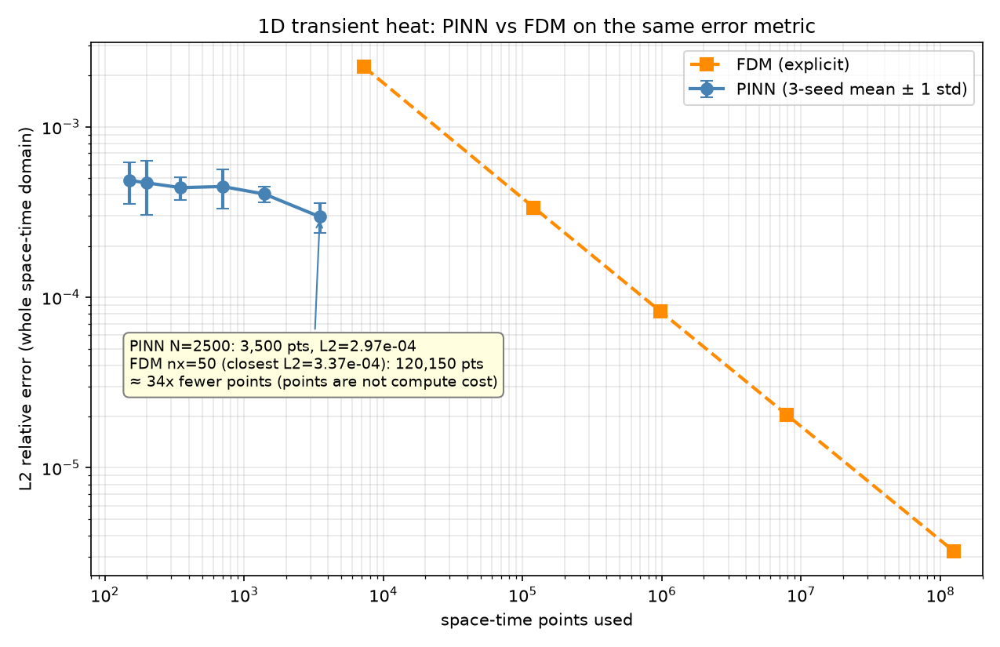
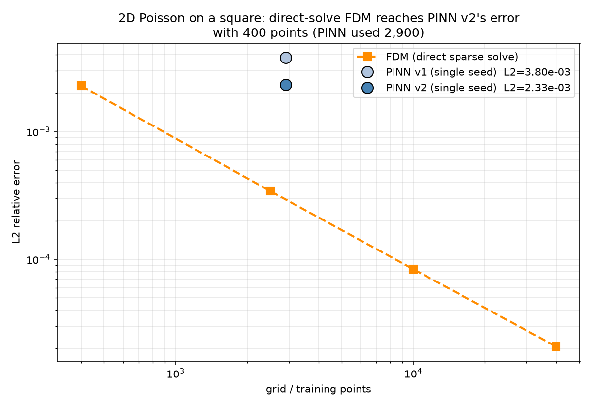

# Physics-Informed Neural Networks for Heat Conduction and Fluid Flow

[](https://www.python.org/)
[](https://www.tensorflow.org/)
[](https://deepxde.readthedocs.io/)
[](LICENSE)
[]()

> **A deep learning framework that embeds thermodynamic and fluid governing equations
> directly into the neural network training process — eliminating the need for
> dense computational meshes while remaining faithful to the underlying physics.**

---

## Table of Contents
- [Overview](#overview)
- [Scientific Motivation](#scientific-motivation)
- [Governing Equations](#governing-equations)
- [Methodology](#methodology)
- [Project Structure](#project-structure)
- [Results](#results)
- [Installation](#installation)
- [Usage](#usage)
- [Engineering Applications](#engineering-applications)
- [Roadmap](#roadmap)
- [References](#references)
- [Author](#author)

---

## Overview

Classical numerical methods — Finite Difference (FDM), Finite Element (FEM), and
Finite Volume (FVM) — have been the backbone of computational mechanics for decades.
They are powerful but carry fundamental limitations: they require structured meshes,
scale poorly to complex geometries, and must be re-solved entirely when boundary
conditions or material parameters change.

**Physics-Informed Neural Networks (PINNs)** offer a fundamentally different
paradigm. Rather than discretizing a domain into a mesh, a neural network learns
to *satisfy* the governing partial differential equations (PDEs) by incorporating
the PDE residual directly into its loss function — enforced at every training point
via automatic differentiation.
The loss function was not used in these forward problems

This project implements PINNs to solve three problems of increasing complexity:

| Problem | PDE | Domain | Difficulty |
|---------|-----|--------|------------|
| 1D Transient Heat Conduction | ∂T/∂t = α ∂²T/∂x² | x ∈ [0,1], t ∈ [0,1] | Baseline |
| 2D Steady-State Heat Conduction | ∂²T/∂x² + ∂²T/∂y² = −Q | (x,y) ∈ [0,1]² | Intermediate |
| Burgers' Equation (Viscous Flow) | ∂u/∂t + u∂u/∂x = ν∂²u/∂x² | x ∈ [−1,1], t ∈ [0,0.99] | Advanced |

Each problem is benchmarked against a classical numerical baseline and validated
against either an analytical solution or a published spectral reference dataset.

---

## Scientific Motivation

Heat conduction and viscous fluid flow are foundational to virtually every
subdomain of mechanical engineering:

- **Thermal management** of electronics, batteries, and aerospace structures
- **Manufacturing processes** — welding, casting, additive manufacturing
- **Energy systems** — heat exchangers, turbines, nuclear reactors
- **Biomedical engineering** — thermal ablation, hyperthermia treatment

The central computational challenge is this: as geometry becomes complex or
operating conditions change, classical solvers require expensive remeshing and
full re-computation. A trained PINN, by contrast, can be queried at any point
in the domain instantaneously — and can be extended to **inverse problems**
(inferring material properties from sparse measurements) without reformulating
the entire solver.

This project focuses on the **forward problem**: given known physics, boundary
conditions, and initial conditions, learn the solution field T(x,t) or u(x,t).
The inverse problem extension is identified as future work.

---

## Governing Equations

### 1. Transient Heat Conduction (1D)

```
∂T/∂t = α ∂²T/∂x²

Boundary conditions:  T(0, t) = 0,   T(1, t) = 0
Initial condition:    T(x, 0) = sin(πx)
Analytical solution:  T(x, t) = exp(−α π² t) · sin(πx)

where α = thermal diffusivity (m²/s) — material dependent
```

Representative Diffusivities:

| Material | α (m²/s) | Application |
|----------|-----------|-------------|
| Copper | 1.17 × 10⁻⁴ | Heat sinks, electronics cooling |
| Aluminum | 9.70 × 10⁻⁵ | Aerospace, automotive structures |
| Carbon Steel | 1.17 × 10⁻⁵ | Structural components, manufacturing |
| Silicon | 8.80 × 10⁻⁵ | Semiconductors, MEMS devices |
| Concrete | 7.00 × 10⁻⁷ | Thermal energy storage, civil |

Non-dimensionalization: the PINN is trained on the dimensionless system
with α* = 0.4. Physical results for carbon steel (α = 1.17×10⁻⁵ m²/s)
are recovered by restoring dimensions:

x_physical = x* × L
t_physical = t* × t_ref,   t_ref = 0.4 · L² / α_real   (≈ 342 s for steel, L = 0.1 m)
T_physical = T* × T_ref

### 2. Steady-State Heat Conduction (2D)

```
∂²T/∂x² + ∂²T/∂y² = −Q(x, y)

Boundary conditions:  T = 0 on all boundaries (Dirichlet)
Source term:          Q(x,y) = sin(πx) · sin(πy)
Analytical solution:  T(x,y) = sin(πx) · sin(πy) / (2π²)
```

### 3. Burgers' Equation (Viscous Flow)

```
∂u/∂t + u · ∂u/∂x = ν · ∂²u/∂x²

Boundary conditions:  u(−1, t) = u(1, t) = 0
Initial condition:    u(x, 0)  = −sin(πx)
Viscosity:            ν = 0.01/π  (shock-forming regime)

Reference solution:   Raissi et al. (2019) spectral dataset
Reference dataset: `burgers_shock.mat` — high-resolution spectral solution
from Raissi et al. (2019), obtained from the
[original paper repository](https://github.com/maziarraissi/PINNs/blob/master/appendix/Data/).
```

This low-viscosity regime (ν = 0.01/π) generates near-discontinuous shock
structures — one of the most challenging scenarios for both classical and
data-driven solvers.

---

## Methodology

### PINN Architecture

A feedforward neural network maps spatial and temporal coordinates to the
solution field:

```
Input:   (x, t)  or  (x, y)          [2 neurons]
Hidden:  4 × 64 neurons, tanh         [physics problems require smooth activations]
Output:  T(x,t)  or  u(x,t)          [1 neuron]
```

The choice of **tanh** activation is deliberate: ReLU and its variants produce
zero second derivatives almost everywhere, making the PDE residual computation
meaningless. Tanh provides the smooth, infinitely differentiable activation
that PDE-constrained training requires.

### Loss Function


### Loss Function

The forward problems in this project are trained on three physics-based terms:

L_total = L_pde + L_bc + L_ic

L_pde = (1/N_c) Σ |∂T/∂t − α ∂²T/∂x²|²     PDE residual at collocation points
L_bc  = (1/N_b) Σ |T(x_boundary) − T_bc|²   Boundary condition enforcement
L_ic  = (1/N_i) Σ |T(x, 0) − T_ic(x)|²      Initial condition enforcement

All terms have unit weight. No measurement-data term is used, since these are
forward problems. A data term L_data (fit to sparse observations) will be added
for the inverse-problem extension. The 2D problem has no initial-condition term.


The PDE residual is computed via **automatic differentiation** (TensorFlow
GradientTape) — the network output T is differentiated with respect to its
inputs (x, t) exactly, with no finite difference approximation.

### Training Strategy

Training proceeds in two stages, which is standard practice for PINNs:

```
Stage 1 — Adam optimizer
  Learning rate: 1×10⁻³ with exponential decay
  Iterations:    20,000
  Purpose:       Rapid initial convergence to solution neighborhood

Stage 2 — L-BFGS-B (quasi-Newton)
  Purpose:       High-precision convergence, exploits smooth loss landscape
  
```

L-BFGS is critical for PINNs: Adam stalls in flat loss regions that L-BFGS
navigates efficiently by approximating the Hessian of the loss surface.

### Collocation Point Sampling

Interior, boundary and initial-condition points are drawn by DeepXDE's
built-in sampler (`train_distribution` default: Hammersley).
Point counts for each experiment are given in the Results tables.
```

---

## Project Structure

```


C:pinn-heat-fluid/
│   .gitignore
│   burgers_test.py
│   data_validation_test.py
│   fdm_baselines_corrected.py
│   LICENSE
│   README.md
│   requirement.txt
│   
├───.vscode
│       settings.json
│       
├───01_heat_1d
│   │   data_efficiency_study.py
│   │   heat1d_fdm_baseline.py
│   │   heat1d_pinn.py
│   │   
│   └───results
│           data_efficiency.png
│           data_efficiency_headline.png
│           data_efficiency_headline_v2.png
│           data_efficiency_results.txt
│           data_efficiency_v2.png
│           data_efficiency_v2_results.txt
│           fdm_heatmap.png
│           one
│           pinn_comparison.png
│           
├───02_heat_2d
│   │   heat2d_fem_baseline.py
│   │   heat2d_pinn.py
│   │   
│   └───results
│           two
│           
├───03_burgers
│   │   burgers_pinn.py
│   │   burgers_shock.mat
│   │   
│   └───results
│           three
│           
├───deepxde
│   │   .codacy.yml
│   │   .gitignore
│   │   .prospector.yaml
│   │   .readthedocs.yaml
│   │   CITATION.cff
│   │   LICENSE
│   │   pyproject.toml
│   │   README.md
│   │   requirements.txt
│   │   
│   ├───.github
│   │   ├───ISSUE_TEMPLATE
│   │   │       config.yml
│   │   │       
│   │   └───workflows
│   │           build.yml
│   │           release.yml
│   │           
│   ├───deepxde
│   │   │   callbacks.py
│   │   │   config.py
│   │   │   display.py
│   │   │   losses.py
│   │   │   metrics.py
│   │   │   model.py
│   │   │   real.py
│   │   │   __init__.py
│   │   │   
│   │   ├───backend
│   │   │   │   backend.py
│   │   │   │   set_default_backend.py
│   │   │   │   utils.py
│   │   │   │   __init__.py
│   │   │   │   
│   │   │   ├───jax
│   │   │   │       tensor.py
│   │   │   │       __init__.py
│   │   │   │       
│   │   │   ├───paddle
│   │   │   │       tensor.py
│   │   │   │       __init__.py
│   │   │   │       
│   │   │   ├───pytorch
│   │   │   │       tensor.py
│   │   │   │       __init__.py
│   │   │   │       
│   │   │   ├───tensorflow
│   │   │   │       tensor.py
│   │   │   │       __init__.py
│   │   │   │       
│   │   │   └───tensorflow_compat_v1
│   │   │           tensor.py
│   │   │           __init__.py
│   │   │           
│   │   ├───data
│   │   │       constraint.py
│   │   │       data.py
│   │   │       dataset.py
│   │   │       fpde.py
│   │   │       function.py
│   │   │       function_spaces.py
│   │   │       func_constraint.py
│   │   │       helper.py
│   │   │       ide.py
│   │   │       mf.py
│   │   │       pde.py
│   │   │       pde_operator.py
│   │   │       quadruple.py
│   │   │       sampler.py
│   │   │       triple.py
│   │   │       __init__.py
│   │   │       
│   │   ├───geometry
│   │   │       csg.py
│   │   │       geometry.py
│   │   │       geometry_1d.py
│   │   │       geometry_2d.py
│   │   │       geometry_3d.py
│   │   │       geometry_nd.py
│   │   │       pointcloud.py
│   │   │       sampler.py
│   │   │       timedomain.py
│   │   │       __init__.py
│   │   │       
│   │   ├───gradients
│   │   │       gradients.py
│   │   │       gradients_forward.py
│   │   │       gradients_reverse.py
│   │   │       jacobian.py
│   │   │       __init__.py
│   │   │       
│   │   ├───icbc
│   │   │       boundary_conditions.py
│   │   │       initial_conditions.py
│   │   │       __init__.py
│   │   │       
│   │   ├───nn
│   │   │   │   activations.py
│   │   │   │   deeponet_strategy.py
│   │   │   │   initializers.py
│   │   │   │   regularizers.py
│   │   │   │   __init__.py
│   │   │   │   
│   │   │   ├───jax
│   │   │   │       fnn.py
│   │   │   │       nn.py
│   │   │   │       __init__.py
│   │   │   │       
│   │   │   ├───paddle
│   │   │   │       deeponet.py
│   │   │   │       fnn.py
│   │   │   │       mfnn.py
│   │   │   │       msffn.py
│   │   │   │       nn.py
│   │   │   │       __init__.py
│   │   │   │       
│   │   │   ├───pytorch
│   │   │   │       deeponet.py
│   │   │   │       fnn.py
│   │   │   │       mionet.py
│   │   │   │       msffn.py
│   │   │   │       nn.py
│   │   │   │       __init__.py
│   │   │   │       
│   │   │   ├───tensorflow
│   │   │   │       deeponet.py
│   │   │   │       fnn.py
│   │   │   │       nn.py
│   │   │   │       __init__.py
│   │   │   │       
│   │   │   └───tensorflow_compat_v1
│   │   │           deeponet.py
│   │   │           fnn.py
│   │   │           mfnn.py
│   │   │           mionet.py
│   │   │           msffn.py
│   │   │           nn.py
│   │   │           resnet.py
│   │   │           __init__.py
│   │   │           
│   │   ├───optimizers
│   │   │   │   config.py
│   │   │   │   __init__.py
│   │   │   │   
│   │   │   ├───jax
│   │   │   │       optimizers.py
│   │   │   │       __init__.py
│   │   │   │       
│   │   │   ├───paddle
│   │   │   │       optimizers.py
│   │   │   │       __init__.py
│   │   │   │       
│   │   │   ├───pytorch
│   │   │   │       nncg.py
│   │   │   │       optimizers.py
│   │   │   │       __init__.py
│   │   │   │       
│   │   │   ├───tensorflow
│   │   │   │       optimizers.py
│   │   │   │       tfp_optimizer.py
│   │   │   │       __init__.py
│   │   │   │       
│   │   │   └───tensorflow_compat_v1
│   │   │           optimizers.py
│   │   │           scipy_optimizer.py
│   │   │           tfp_optimizer.py
│   │   │           __init__.py
│   │   │           
│   │   ├───utils
│   │   │       array_ops_compat.py
│   │   │       external.py
│   │   │       internal.py
│   │   │       jax.py
│   │   │       paddle.py
│   │   │       pytorch.py
│   │   │       tensorflow.py
│   │   │       tensorflow_compat_v1.py
│   │   │       __init__.py
│   │   │       
│   │   └───zcs
│   │           gradient.py
│   │           model.py
│   │           operator.py
│   │           __init__.py
│   │           
│   ├───deepxde_practice
│   │       test_1.py
│   │       test_2.py
│   │       test_tensorflow.py
│   │       
│   ├───docker
│   │       Dockerfile
│   │       requirements.txt
│   │       
│   ├───docs
│   │   │   conf.py
│   │   │   index.rst
│   │   │   make.bat
│   │   │   Makefile
│   │   │   requirements.txt
│   │   │   
│   │   ├───demos
│   │   │   │   function.rst
│   │   │   │   operator.rst
│   │   │   │   pinn_forward.rst
│   │   │   │   pinn_inverse.rst
│   │   │   │   
│   │   │   ├───function
│   │   │   │       dataset.rst
│   │   │   │       func.rst
│   │   │   │       
│   │   │   ├───operator
│   │   │   │       antiderivative_aligned.rst
│   │   │   │       antiderivative_unaligned.rst
│   │   │   │       poisson.1d.pideeponet.rst
│   │   │   │       poisson_1d_pideeponet.png
│   │   │   │       stokes.png
│   │   │   │       zcs.rst
│   │   │   │       
│   │   │   ├───pinn_forward
│   │   │   │       allen.cahn.rst
│   │   │   │       american.put.rst
│   │   │   │       black_scholes.rst
│   │   │   │       burgers.rar.rst
│   │   │   │       burgers.rst
│   │   │   │       diffusion.1d.exactBC.rst
│   │   │   │       diffusion.1d.resample.rst
│   │   │   │       diffusion.1d.rst
│   │   │   │       diffusion.reaction.rst
│   │   │   │       elasticity.plate.rst
│   │   │   │       eulerbeam.rst
│   │   │   │       heat.resample.rst
│   │   │   │       heat.rst
│   │   │   │       helmholtz.2d.dirichlet.hpo.rst
│   │   │   │       helmholtz.2d.dirichlet.rst
│   │   │   │       helmholtz.2d.neumann.hole.rst
│   │   │   │       helmholtz.2d.sound.hard.abc.rst
│   │   │   │       klein.gordon.rst
│   │   │   │       Kovasznay.flow.rst
│   │   │   │       laplace.disk.rst
│   │   │   │       lotka.volterra.rst
│   │   │   │       ode.2nd.rst
│   │   │   │       ode.system.rst
│   │   │   │       poisson.1d.dirichlet.rst
│   │   │   │       poisson.1d.dirichletperiodic.rst
│   │   │   │       poisson.1d.dirichletrobin.rst
│   │   │   │       poisson.1d.multiscaleFourier.rst
│   │   │   │       poisson.1d.neumanndirichlet.rst
│   │   │   │       poisson.1d.pointsetoperator.rst
│   │   │   │       poisson.dirichlet.1d.exactbc.rst
│   │   │   │       poisson.Lshape.rst
│   │   │   │       
│   │   │   └───pinn_inverse
│   │   │           diffusion.1d.inverse.rst
│   │   │           elliptic.inverse.field.rst
│   │   │           lorenz.inverse.forced.rst
│   │   │           lorenz.inverse.rst
│   │   │           reaction.inverse.rst
│   │   │           
│   │   ├───images
│   │   │       backend.png
│   │   │       dataparallel.png
│   │   │       deeponet.png
│   │   │       mfnn.png
│   │   │       pinn.png
│   │   │       scaling.png
│   │   │       
│   │   ├───modules
│   │   │       deepxde.backend.jax.rst
│   │   │       deepxde.backend.paddle.rst
│   │   │       deepxde.backend.pytorch.rst
│   │   │       deepxde.backend.rst
│   │   │       deepxde.backend.tensorflow.rst
│   │   │       deepxde.backend.tensorflow_compat_v1.rst
│   │   │       deepxde.data.rst
│   │   │       deepxde.geometry.rst
│   │   │       deepxde.gradients.rst
│   │   │       deepxde.icbc.rst
│   │   │       deepxde.nn.jax.rst
│   │   │       deepxde.nn.paddle.rst
│   │   │       deepxde.nn.pytorch.rst
│   │   │       deepxde.nn.rst
│   │   │       deepxde.nn.tensorflow.rst
│   │   │       deepxde.nn.tensorflow_compat_v1.rst
│   │   │       deepxde.optimizers.jax.rst
│   │   │       deepxde.optimizers.paddle.rst
│   │   │       deepxde.optimizers.pytorch.rst
│   │   │       deepxde.optimizers.rst
│   │   │       deepxde.optimizers.tensorflow.rst
│   │   │       deepxde.optimizers.tensorflow_compat_v1.rst
│   │   │       deepxde.rst
│   │   │       deepxde.utils.rst
│   │   │       
│   │   └───user
│   │           cite_deepxde.rst
│   │           faq.rst
│   │           installation.rst
│   │           parallel.rst
│   │           research.rst
│   │           team.rst
│   │           
│   └───examples
│       │   Makefile
│       │   sample_to_test.py
│       │   
│       ├───dataset
│       │       Allen_Cahn.mat
│       │       Burgers.npz
│       │       cylinder_nektar_wake.mat
│       │       dataset.test
│       │       dataset.train
│       │       Lorenz.npz
│       │       mf_hi_test.dat
│       │       mf_hi_train.dat
│       │       mf_lo_train.dat
│       │       Poisson_Lshape.npz
│       │       reaction.npz
│       │       stokes.npz
│       │       
│       ├───function
│       │       dataset.py
│       │       func.py
│       │       func_uncertainty.py
│       │       mf_dataset.py
│       │       mf_func.gpi
│       │       mf_func.py
│       │       
│       ├───operator
│       │       ADR_solver.py
│       │       advection_aligned_pideeponet.py
│       │       advection_aligned_pideeponet_2d.py
│       │       advection_unaligned_pideeponet.py
│       │       advection_unaligned_pideeponet_2d.py
│       │       antiderivative_aligned.py
│       │       antiderivative_aligned_pideeponet.py
│       │       antiderivative_unaligned.py
│       │       antiderivative_unaligned_pideeponet.py
│       │       diff_rec_aligned_pideeponet.py
│       │       diff_rec_aligned_zcs_pideeponet.py
│       │       diff_rec_unaligned_pideeponet.py
│       │       poisson_1d_pideeponet.py
│       │       stokes_aligned_pideeponet.py
│       │       stokes_aligned_zcs_pideeponet.py
│       │       
│       ├───pinn_forward
│       │       Allen_Cahn.py
│       │       american_put.py
│       │       Beltrami_flow.py
│       │       black_scholes_call.py
│       │       Burgers.py
│       │       Burgers_RAR.py
│       │       diffusion_1d.py
│       │       diffusion_1d_exactBC.py
│       │       diffusion_1d_resample.py
│       │       diffusion_reaction.py
│       │       elasticity_plate.py
│       │       Euler_beam.py
│       │       fractional_diffusion_1d.py
│       │       fractional_Poisson_1d.py
│       │       fractional_Poisson_2d.py
│       │       fractional_Poisson_3d.py
│       │       heat.py
│       │       heat_resample.py
│       │       Helmholtz_Dirichlet_2d.py
│       │       Helmholtz_Dirichlet_2d_HPO.py
│       │       Helmholtz_Neumann_2d_hole.py
│       │       Helmholtz_Sound_hard_ABC_2d.py
│       │       ide.py
│       │       Klein_Gordon.py
│       │       Kovasznay_flow.py
│       │       Laplace_disk.py
│       │       Lotka_Volterra.py
│       │       ode_2nd.py
│       │       ode_system.py
│       │       Poisson_Dirichlet_1d.py
│       │       Poisson_Dirichlet_1d_exactBC.py
│       │       Poisson_Lshape.py
│       │       Poisson_multiscale_1d.py
│       │       Poisson_Neumann_1d.py
│       │       Poisson_periodic_1d.py
│       │       Poisson_PointSetOperator_1d.py
│       │       Poisson_Robin_1d.py
│       │       Schrodinger.ipynb
│       │       Volterra_IDE.py
│       │       wave_1d.py
│       │       
│       └───pinn_inverse
│               brinkman_forchheimer.py
│               diffusion_1d_inverse.py
│               diffusion_reaction_rate.py
│               elliptic_inverse_field.py
│               elliptic_inverse_field_batch.py
│               fractional_Poisson_1d_inverse.py
│               fractional_Poisson_2d_inverse.py
│               Lorenz_inverse.py
│               Lorenz_inverse_forced.py
│               Navier_Stokes_inverse.py
│               reaction_inverse.py
│               
├───deepxde_practice
│       test_1.py
│       test_2.py
│       test_tensorflow.py
│       
├───notebooks
│       01_exploratory.ipynb
│       02_visualization.ipynb
│       
├───report
│   │   main.tex
│   │   
│   └───figures
│           rep
│           
├───results
│       data_efficiency.png
│       data_efficiency_headline.png
│       data_efficiency_results.txt
│       fdm_baselines_corrected.txt
│       fdm_final_comparison.png
│       fdm_heatmap.png
│       fdm_refinement.png
│       fdm_time_slices.png
│       heat2d_3d_surface.png
│       heat2d_3d_surface_v2.png
│       heat2d_comparison.png
│       heat2d_comparison_v2.png
│       heat2d_cross_sections.png
│       heat2d_cross_sections_v2.png
│       heat2d_error_analysis_v2.png
│       heat2d_loss.png
│       heat2d_model-20779.weights.h5
│       heat2d_model_v2-30916.weights.h5
│       heat2d_summary.txt
│       heat2d_summary_v2.txt
│       heat2d_v1_v2_comparison.png
│       
└───utils
        metrics.py
        plotting.py


---

## Results

> **Note:** This project is actively in progress. Results will be updated
> as each phase completes. Current status: FDM baseline complete ✓,
> PINN training in progress.

### FDM Baseline — 1D Heat Equation

The classical FDM solver establishes the benchmark this project aims to match
and exceed with significantly fewer computational points.

**Grid Refinement Study** — confirms second-order spatial accuracy of the
FDM baseline, as expected for central difference discretization:

**Grid refinement study** (explicit FDM, error over all nodes and time steps):

| nx | Space-time points | L2 relative error |
|----|-------------------|-------------------|
| 20 | 7,260 | 2.25×10⁻³ |
| 50 | 120,150 | 3.37×10⁻⁴ |
| 100 | 980,200 | 8.25×10⁻⁵ |
| 200 | 7,920,400 | 2.04×10⁻⁵ |
| 500 | 124,501,500 | 3.25×10⁻⁶ |

Error falls about 4× per doubling of nx (observed order ≈ 2), as expected
for central differences.

**FDM Solution — Temperature Field T(x,t):**


### Key Result — Data Efficiency of PINNs vs Classical FDM

> **Research question:** How many physics-constrained training points does a
> PINN need to match the accuracy of a classical finite difference solver
> that uses orders of magnitude more grid points?

### Key Result — Data Efficiency of PINNs vs Classical FDM

### Problem 1: 1D Transient Heat Conduction

| Method | Space-time points | L2 relative error |
|--------|-------------------|-------------------|
| PINN, N=50 (3-seed mean) | 150 | 4.86×10⁻⁴ |
| PINN, N=100 | 200 | 4.69×10⁻⁴ |
| PINN, N=250 | 350 | 4.40×10⁻⁴ |
| PINN, N=500 | 700 | 4.47×10⁻⁴ |
| PINN, N=1000 | 1,400 | 4.04×10⁻⁴ |
| **PINN, N=2500** | **3,500** | **2.97×10⁻⁴** |
| FDM, nx=20 | 7,260 | 2.25×10⁻³ |
| **FDM, nx=50** | **120,150** | **3.37×10⁻⁴** |
| FDM, nx=100 | 980,200 | 8.25×10⁻⁵ |
| FDM, nx=200 | 7,920,400 | 2.04×10⁻⁵ |


The PINN (N=2500) reaches the accuracy of a 120,150-point explicit FDM grid
with about 34× fewer points. Differences among PINN runs from N=50 to N=1000
are within one standard deviation across seeds. FDM is far cheaper in
wall-clock time here (about 0.12 s versus about 17 min of PINN training).



- Figures and summary files built on the old baselines were removed; baseline-dependent
  figures were regenerated by `make_corrected_figures.py`.

### Results by Problem

Single run (seed 42, 4×64 tanh, 20k Adam + L-BFGS, 2,900 points):
L2 = 1.55×10⁻⁴, L∞ = 3.53×10⁻⁴, 714 s on CPU.

FDM is faster for simple 1D cases. PINN advantage emerges in complex geometry, inverse problems, and multi-physics settings.

#### Problem 2 — 2D Steady-State Heat Conduction

### Problem 2: 2D Steady-State Heat Conduction

| Method | Points | L2 relative error | Time |
|--------|--------|-------------------|------|
| FDM 20×20 (direct solve) | 400 | 2.28×10⁻³ | 0.01 s |
| FDM 50×50 | 2,500 | 3.43×10⁻⁴ | 0.02 s |
| FDM 100×100 | 10,000 | 8.39×10⁻⁵ | 0.08 s |
| PINN v1 ( 20k Adam) | 2,900 | 3.80×10⁻³ | ~22 min |
| PINN v2 (6×64, 30k Adam, LR decay) | 2,900 | 2.33×10⁻³ | ~46 min |

For this smooth problem on a rectangle, classical FDM is both more accurate
and orders of magnitude cheaper. PINNs are not competitive here; their
potential advantages are in irregular geometry and inverse problems (see Roadmap).
The v1→v2 change is a single-seed result with three changes made at once.


- Figures and summary files built on the old baselines were removed; baseline-dependent
  figures were regenerated by `make_corrected_figures.py`.


Note: "For simple rectangular domains, FDM remains computationally faster. The PINN advantage becomes decisive in irregular geometries, inverse problems, and multi-physics settings where FDM requires complete remeshing. No  GPU was used in any of the code executions"

## Corrections log
- An early 2D FDM baseline used an under-converged Gauss-Seidel iteration and
  an early 1D comparison scored FDM at the final time only. Both were replaced by
  `fdm_baselines_corrected.py` (direct sparse solve; whole-domain space-time metric).


#### Problem 3 — Burgers' Equation (Viscous Flow)

| Metric | Spectral Reference | PINN | Notes |
|--------|--------------------|------|-------|
| L2 Relative Error | — (reference) | ⏳ | Raissi 2019 reports  3.93×10⁻⁴ |
| L∞ Error | — (reference) | ⏳ | — |
| Shock region error | — | ⏳ | Key challenge region |


## Corrections log
- An early 2D FDM baseline used an under-converged Gauss-Seidel iteration and
  an early 1D comparison scored FDM at the final time only. Both were replaced by
  `fdm_baselines_corrected.py` (direct sparse solve; whole-domain space-time metric).
---

### Architecture Study *(In Progress)*

Which neural network configuration best solves physics-constrained PDEs?

| Architecture | Activation | Parameters | L2 Error | Training Time |
|-------------|------------|------------|----------|---------------|
| [2, 20×3, 1] | tanh | ~1,300 | ⏳ | ⏳ |
| [2, 64×4, 1] | tanh | ~16,500 | ⏳ | ⏳ |
| [2, 64×4, 1] | sin (SIREN) | ~16,500 | ⏳ | ⏳ |
| [2, 64×4, 1] | swish | ~16,500 | ⏳ | ⏳ |
| [2, 64×6, 1] | tanh | ~24,700 | ⏳ | ⏳ |

*Hypothesis: tanh and sin activations will outperform ReLU because
PDE residual computation requires smooth, non-zero second derivatives.*

.

---

## Installation

```bash
# 1. Clone the repository
git clone https://github.com/Mathewboat/Pinn-heat-fluid.git
cd cd Pinn-heat-fluid

# 2. Create and activate virtual environment
python -m venv pinn_env

# Windows
pinn_env\Scripts\activate
# Mac / Linux
source pinn_env/bin/activate

# 3. Install dependencies
pip install -r requirements.txt

# 4. Set DeepXDE backend
# Windows (PowerShell)
$env:DDE_BACKEND="tensorflow"
# Mac / Linux
export DDE_BACKEND=tensorflow
```

**requirements.txt:**
```
tensorflow>=2.21
deepxde>=1.15
numpy>=1.24
scipy>=1.11
matplotlib>=3.7
scikit-learn>=1.3
pandas>=2.0
jupyter>=1.0
imageio>=2.31
tqdm>=4.65
```

**Python version:** 3.8–3.11 required (TensorFlow constraint)

---

## Usage

### Run the FDM Baseline

```bash
cd 01_heat_1d
python heat1d_fdm_baseline.py
```

Outputs four figures to `01_heat_1d/results/` and prints error metrics
and grid refinement table to terminal.

### Run the PINN Solver *(in progress)*

```bash
cd 01_heat_1d
python heat1d_pinn.py
```

### Reproduce All Results

```bash
cd 01_heat_1d
python heat1d_fdm_baseline.py
python heat1d_pinn.py
python data_efficiency_study.py
cd ../02_heat_2d
python heat2d_pinn.py
cd ..
python fdm_baselines_corrected.py
cd 03_burgers      # download burgers_shock.mat here first
python burgers_pinn.py --config baseline --seed 42
```

---

## Engineering Applications

The methods developed in this project have direct relevance to open problems
in mechanical engineering research:

**Thermal Management of Electronics**
Modern processors dissipate 100+ W/cm². PINN-based solvers could enable
real-time thermal field reconstruction from sparse thermocouple measurements
— an inverse problem extension of this work.

**Additive Manufacturing**
Laser powder bed fusion involves rapid, localized heat input creating steep
thermal gradients. Classical FEM solvers require millions of elements and
hours of compute time. PINNs offer a path to faster thermal history prediction
for microstructure control.

**Turbomachinery**
Burgers' equation is a canonical model for shock waves in compressible flow —
directly relevant to blade passage flows in turbines and compressors. The
shock-capturing capability studied in Problem 3 maps to these applications.

**Digital Twins**
PINNs can assimilate sparse sensor data while remaining consistent with
governing physics — a key capability for physics-augmented digital twin
frameworks in structural health monitoring and process control.

---

## Roadmap

- [x] Repository setup and documentation
- [x] FDM baseline solver — 1D heat equation
- [x] Grid refinement study and error analysis
- [ ] PINN solver — 1D heat equation (Days 9–13)
- [ ] PINN vs FDM data efficiency comparison
- [ ] PINN solver — 2D steady-state heat equation (Days 14–18)
- [ ] PINN solver — Burgers' equation (Days 19–24)
- [ ] Architecture and activation function study
- [ ] Full results table and figures
- [ ] Technical report (LaTeX, ASME format)
- [ ] arXiv preprint submission

---

## References

1. **Raissi, M., Perdikaris, P., & Karniadakis, G. E. (2019).**
   Physics-informed neural networks: A deep learning framework for solving
   forward and inverse problems involving nonlinear partial differential equations.
   *Journal of Computational Physics*, 378, 686–707.
   https://doi.org/10.1016/j.jcp.2018.10.045

2. **Lu, L., Meng, X., Mao, Z., & Karniadakis, G. E. (2021).**
   DeepXDE: A deep learning library for solving differential equations.
   *SIAM Review*, 63(1), 208–228.
   https://doi.org/10.1137/19M1274067

3. **Cuomo, S., Di Cola, V. S., Giampaolo, F., Rozza, G., Raissi, M.,
   & Piccialli, F. (2022).**
   Scientific machine learning through physics-informed neural networks:
   Where we are and what's next.
   *Journal of Scientific Computing*, 92(3), 88.
   https://arxiv.org/abs/2201.05624

4. **Cai, S., Wang, Z., Wang, S., Perdikaris, P., & Karniadakis, G. E. (2021).**
   Physics-informed neural networks for heat transfer problems.
   *Journal of Heat Transfer*, 143(6).
   https://arxiv.org/abs/2101.01630

5. **Karniadakis, G. E., Kevrekidis, I. G., Lu, L., Perdikaris, P.,
   Wang, S., & Yang, L. (2021).**
   Physics-informed machine learning.
   *Nature Reviews Physics*, 3(6), 422–440.
   https://doi.org/10.1038/s42254-021-00314-5

6. **Brunton, S. L., Noack, B. R., & Sagaut, P. (2020).**
   Machine learning for fluid mechanics.
   *Annual Review of Fluid Mechanics*, 52, 477–508.
   https://doi.org/10.1146/annurev-fluid-010719-060214

---

## Author

**Mathew Ahenkora Boateng**
Prospective Graduate Applicant, Mechanical Engineering
Kwame Nkrumah University of Science and Technology (KNUST)

- 📧 mkwameboateng@gmail.com
- 🔗 [linkedin.com/in/mathew-ahenkora-boateng-7222011b6](https://www.linkedin.com/in/mathew-ahenkora-boateng-7222011b6)
- 🐙 [github.com/Mathewboat](https://github.com/Mathewboat)

*Applying for PhD programs in Mechanical Engineering (Fall 2027 intake),
with research interests in computational mechanics, scientific machine learning,
and physics-informed methods for thermal and fluid systems.*

---

## Acknowledgements

This project builds on the foundational PINN framework developed by
Raissi, Perdikaris & Karniadakis (2019) and uses the DeepXDE library
developed by Lu et al. (2021). Reference spectral data for the Burgers'
equation is from the original PINN paper's supplementary repository.

---

*Last updated: October 2026 · Status: In Progress*
